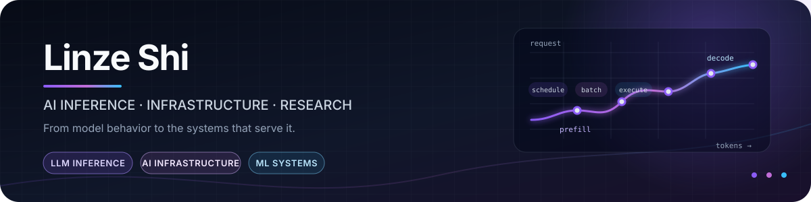

  

  <strong>Exploring how AI research becomes efficient, usable systems.</strong>

  LLM Inference &nbsp;·&nbsp; AI Infrastructure &nbsp;·&nbsp; ML Systems &nbsp;·&nbsp; Research Engineering

## About

I'm interested in AI at the boundary between **research and systems**: understanding how models work, then building the infrastructure that makes them practical. Right now, I'm going deep on LLM inference—from scheduling and batching to KV-cache management and distributed execution.

## Research ↔ Systems

| Research lens | Systems lens |
| --- | --- |
| Read papers, reproduce ideas, and question assumptions | Trace real execution, measure tradeoffs, and build working implementations |
| Study model and agent behavior | Improve serving efficiency, memory use, and developer experience |

## Current focus

- Understanding inference engines end to end: **prefill, decode, scheduling, batching, and sampling**
- Exploring **efficient serving**, GPU-aware execution, and distributed inference
- Turning what I learn into **small experiments, technical notes, and open-source work**

  Learning in public, one system at a time.

